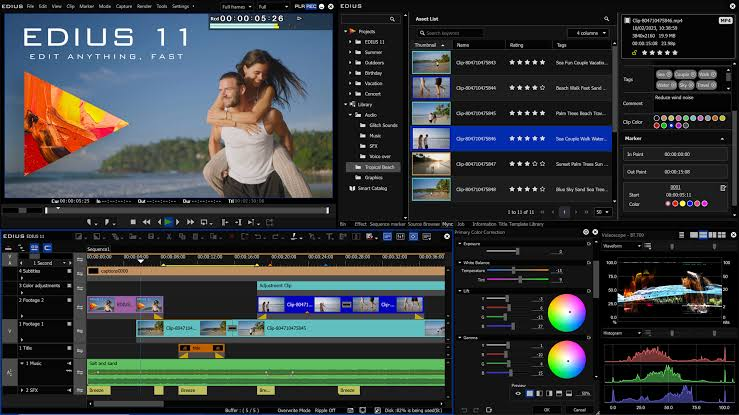
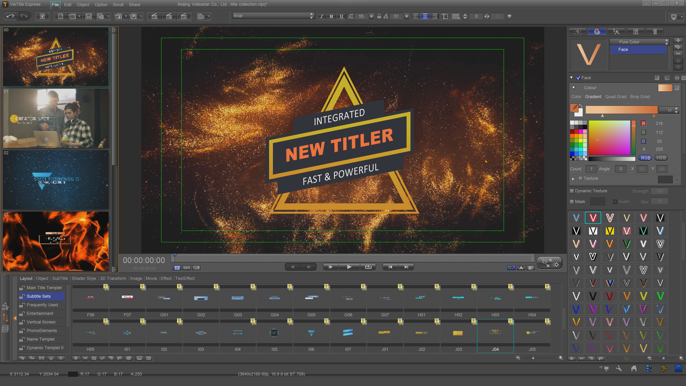
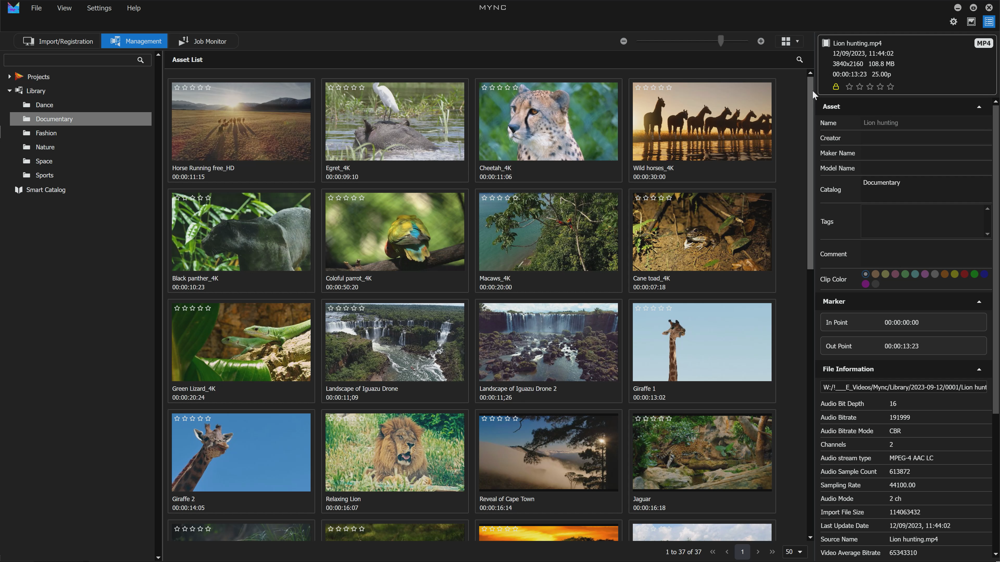

# EDIUS 11 Pro Real-Time Video Editing

EDIUS 11 Pro is professional non-linear editing software for Windows. It is designed for responsive timeline editing, mixed-format projects, 4K and HDR production, multicamera work, media organization, and delivery to broadcast, web, and social platforms.

The edius pro workflow combines timeline tools with Mync 11 media management. Grass Valley also offers separate products and services for shared projects, external rendering, and larger collaborative environments.

[](https://edius-11-pro.github.io/edius-pro/)

## Feature Overview

EDIUS 11 Pro focuses on fast editing without requiring every source clip to be converted to a single intermediate format before it reaches the timeline.

| Area | Capabilities |
|---|---|
| Timeline | Real-time editing, trimming, transitions, nested sequences |
| Media | Mixed resolutions, frame rates, codecs, and color formats |
| Picture | SD, HD, 4K, HDR, color correction, and LUT workflows |
| Audio | Mixing, filters, synchronization, and VST3 support |
| Multicam | Editing of synchronized material from multiple sources |
| Management | Mync 11 assets, markers, metadata, jobs, and projects |
| Effects | Native filters, transitions, adjustment clips, and OFX support |
| Delivery | Export presets for production and social media targets |

Core workflow areas include:

- Importing video, audio, graphics, and image sequences.
- Organizing footage before timeline editing.
- Combining media with different technical properties.
- Applying corrections and effects across individual or adjustment clips.
- Synchronizing and switching multicamera recordings.
- Exporting finished sequences with suitable codec and container settings.



## Real-Time Timeline Workflow

The edius 11 pro timeline is designed for direct manipulation of clips, tracks, transitions, effects, markers, and sequences.

Editors can trim material in the player or timeline, build layered compositions, adjust clip timing, and monitor the result while continuing to refine the sequence.

### Practical Timeline Checklist

- Confirm project resolution, frame rate, and color space.
- Organize source clips before assembling the main sequence.
- Use track patches deliberately when inserting material.
- Add sequence markers for review notes and delivery points.
- Keep autosave enabled for long editing sessions.

PowerShell can create a checksum before media is copied or archived:

```powershell
Get-FileHash "D:\Media\Interview-01.mov" -Algorithm SHA256
```

This is a Windows PowerShell command, not an EDIUS command. Store the hash with the production notes when file integrity matters.

## Media and Format Handling

EDIUS is known for working with varied camera and delivery formats in one project. Actual decoding, hardware acceleration, and export choices depend on the media format, installed hardware, edition, and current software build.

| Workflow | Items to verify |
|---|---|
| Mixed cameras | Frame rates, timecode, audio layout, and color metadata |
| 4K editing | Storage speed, decoder support, GPU capability, and proxy needs |
| HDR | Project color space, monitoring path, scopes, and export metadata |
| RAW media | Supported camera SDK and current EDIUS update |
| Long GOP media | Hardware decoder availability and playback performance |

The official update history should be checked when a production depends on a newly released camera or codec.



## Mync 11 Media Management

Mync 11 is included with EDIUS 11 and provides asset, project, sequence, transcoding, and job-management functions.

A structured media workflow can use Mync to:

- Review and catalog source material.
- Define clip colors, markers, comments, and in or out points.
- Search assets using available metadata.
- Start an EDIUS project from selected material.
- Monitor background transcoding and related jobs.

The Mync window inside EDIUS makes managed assets available during editing without requiring a separate manual catalog for every sequence.

### Storage Planning

Keep original media, cache data, project files, and final exports in clearly separated locations. Back up project files and irreplaceable camera media to more than one physical device.

## Multicam Editing

EDIUS supports multicamera production workflows with source synchronization and timeline switching.

Before creating a multicam sequence:

- Confirm that every camera uses the intended frame rate.
- Preserve original timecode when it is reliable.
- Record reference audio on each source where possible.
- Name angles consistently.
- Check synchronization before making extensive cuts.
- Review audio routing independently from picture switching.

The quality of a multicamera edit depends on source preparation as much as timeline operation.

### Inspect Media with FFprobe

FFprobe can inspect technical metadata before clips are imported:

```powershell
ffprobe -v error -show_entries stream=index,codec_name,width,height,r_frame_rate `
  -of default=noprint_wrappers=1 "D:\Media\Camera-A-001.mov"
```

FFprobe is part of FFmpeg and is not an EDIUS command. It can help identify mismatched source properties during troubleshooting.

## Audio, Speech, and Effects

Recent EDIUS 11 updates added AI-powered speech-to-text capabilities. Available behavior can depend on the installed build, language support, and configured services.

Audio production may include:

- Clip and track level adjustments.
- Waveform-based synchronization.
- Noise reduction through included or compatible tools.
- Voice, music, and effects balancing.
- VST3 plug-in processing.
- Export checks for channel layout and loudness.

The edius 11 workflow should preserve an unprocessed copy of important recordings before destructive external processing.

### Adjustment Clips and OFX

Adjustment clips let editors apply compatible corrections or effects across a timeline range. Native OFX support expands access to compatible third-party visual effects.

Test plug-ins with representative footage before relying on them in a deadline-sensitive project.

## Color, HDR, and Export

Grass Valley EDIUS Pro supports color correction, LUT-based workflows, HDR projects, and output to multiple delivery formats.

| Stage | Review point |
|---|---|
| Source | Camera gamma, gamut, bit depth, and metadata |
| Project | Timeline resolution, frame rate, and color space |
| Correction | Exposure, balance, legal range, and shot matching |
| Monitoring | Display capability and signal path |
| Export | Codec, profile, level, bitrate, and color metadata |
| Quality control | Playback, audio sync, captions, and file integrity |

Social media export presets provide practical targets, but the final settings should still match the current requirements of the destination platform.



## Open-Source NLE Reference Files

EDIUS is proprietary software. The local files linked below come from Shotcut, a separate open-source video editor, and do not contain EDIUS source code.

Build and documentation references:

- [CMakeLists.txt](CMakeLists.txt)
- [CMakePresets.json](CMakePresets.json)
- [FindClangFormat.cmake](cmake/FindClangFormat.cmake)
- [qml-api.qdocconf](docs/qml-api.qdocconf)
- [shotcut.css](docs/shotcut.css)
- [index.qdoc](docs/src/index.qdoc)
- [org-shotcut-qml.qdoc](docs/src/org-shotcut-qml.qdoc)
- [shotcut-controls.qdoc](docs/src/shotcut-controls.qdoc)
- [shotcut-controls-types.qdoc](docs/src/shotcut-controls-types.qdoc)

Filter, script, and test references:

- [Soft Focus](filter-sets/Soft%20Focus)
- [Glow Intensity](filter-sets/Glow%20Intensity)
- [Obscure With Blur](filter-sets/Obscure%20With%20Blur)
- [Text Simple with Gradient Back](filter-sets/Text%20Simple%20with%20Gradient%20Back)
- [build-shotcut.sh](scripts/build-shotcut.sh)
- [build-shotcut-msys2.sh](scripts/build-shotcut-msys2.sh)
- [make-ico.py](scripts/make-ico.py)
- [test_exportpresetdialog.cpp](tests/test_exportpresetdialog.cpp)

### Reference Build Command

The partial source snapshot includes a Shotcut build script:

```bash
bash scripts/build-shotcut.sh
```

This command belongs to the Shotcut reference project. It does not build, modify, activate, or automate EDIUS.

## System and License Considerations

Check the current official specification before purchasing or upgrading because supported Windows versions, processors, GPUs, memory, storage, and camera formats can change between releases.

- EDIUS 11 is Windows-based software.
- A fast multicore processor improves decoding and export performance.
- Sufficient RAM is important for large projects and high-resolution media.
- Fast storage helps with multicamera, 4K, and high-bitrate footage.
- Supported GPU hardware can accelerate compatible decoding and rendering.
- One EDIUS 11 license permits one activation according to the official product page.

EDIUS X users should compare upgrade eligibility, plug-in compatibility, project requirements, and licensing before moving to EDIUS 11.

## Frequently Asked Questions

### What is EDIUS 11 Pro used for?

It is used for professional timeline editing, broadcast and web production, multicamera projects, 4K and HDR workflows, audio processing, media management, and final export.

### Is EDIUS available for macOS?

EDIUS 11 is designed for Windows. Mac users need a supported Windows environment or a different editor built for macOS.

### Does EDIUS include Mync?

Mync 11 is included with EDIUS 11. Chorus Hub collaboration is a separate product rather than a standard EDIUS Pro feature.

## Related Search Terms

edius 11 pro, edius pro, edius 11, edius x, grass valley edius pro, video-editor, video-editing, non-linear-editing, windows, 4k-video, hdr-video, multicam-editing, media-management, post-production, nle
